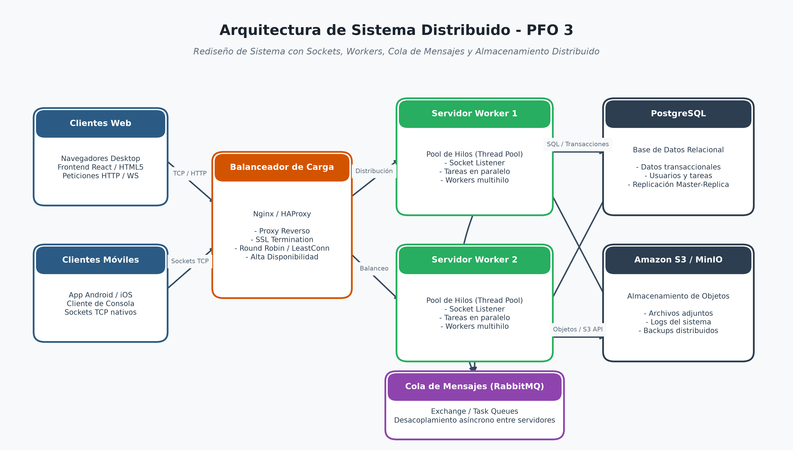
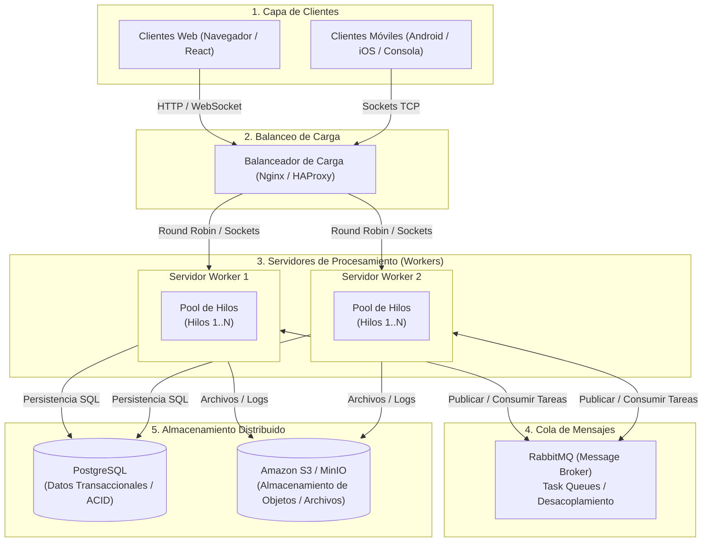

# PFO 3: Rediseño como Sistema Distribuido (Cliente-Servidor)

- **Carrera:** Tecnicatura Superior en Desarrollo de Software  
- **Alumno:** Juan Pablo Pontini  
- **Materia:** Programación sobre Redes  

---

## Descripción del Proyecto

Para este trabajo práctico rediseñé la arquitectura del sistema transformándola en una **arquitectura distribuida** basada en sockets TCP y procesamiento concurrente mediante un **pool de workers**.

El proyecto se compone de dos partes fundamentales:
1. **Diseño arquitectónico:** Modelado conceptual de un sistema distribuido escalable y de alta disponibilidad que integra clientes heterogéneos, balanceo de carga, servidores con pool de hilos, colas de mensajes y almacenamiento distribuido.
2. **Implementación práctica en Python:** Desarrollo de un servidor de tareas basado en sockets TCP que distribuye el trabajo entrante a un pool de workers multihilo, y un cliente interactivo que despacha tareas y recibe los resultados procesados en tiempo real.

---

## 1. Diagrama del Sistema Distribuido

A continuación se presenta el diagrama general de la arquitectura diseñada para el sistema:



### Representación del Flujo del Sistema (Mermaid)



---

### Componentes de la Arquitectura

1. **Clientes (Móviles y Web):**
   * **Clientes Web:** Acceden mediante navegadores utilizando protocolos HTTP y WebSockets para interfaces gráficas e interactivas.
   * **Clientes Móviles / Consola:** Se conectan de manera nativa mediante **sockets TCP** para operaciones directas, ligeras y de baja latencia.

2. **Balanceador de Carga (Nginx / HAProxy):**
   * Actúa como punto de entrada único (Reverse Proxy) distribuyendo el tráfico entrante hacia los diferentes nodos servidores.
   * Proporciona **terminación SSL/TLS**, balanceo por algoritmos como *Round Robin* o *Least Connections*, y chequeos de salud (*Health Checks*) para aislar nodos caídos y asegurar alta disponibilidad.

3. **Servidores Workers (cada uno con su pool de hilos):**
   * Cada servidor mantiene un **pool de workers (hilos concurrentes)** que atienden las tareas sin bloquear el hilo principal receptor de red.
   * La recepción de conexiones por socket y el cómputo se encuentran desacoplados mediante colas internas, permitiendo procesar múltiples tareas en paralelo según la capacidad de hardware del nodo.

4. **Cola de Mensajes (RabbitMQ):**
   * Permite la comunicación asíncrona y el desacoplamiento total entre los servidores de la arquitectura.
   * Si la demanda supera la capacidad inmediata de los workers, las tareas se retienen de forma segura en colas persistentes (*Task Queues*), evitando la saturación del sistema y garantizando que ningún trabajo se pierda.

5. **Almacenamiento Distribuido:**
   * **PostgreSQL:** Base de datos relacional para datos estructurados (usuarios, estados de tareas, trazabilidad y control transaccional ACID). Permite esquemas con replicación *Master-Replica*.
   * **Amazon S3 / MinIO:** Almacenamiento de objetos distribuido para archivos pesados, imágenes, documentos generados y backups del sistema.

---

## 2. Implementación en Python

La solución práctica implementada en Python reproduce los conceptos clave de la arquitectura: recepción de tareas mediante **sockets TCP**, encolamiento interno y distribución concurrente a un **pool de hilos workers**.

### Estructura de Archivos
* `servidor.py`: Servidor multihilo con socket TCP (`localhost:6000`), cola de tareas, pool de 4 workers concurrentes y registro de eventos con logging.
* `cliente.py`: Cliente interactivo por consola que permite despachar tareas individuales o por lotes simultáneos.
* `servidor.log`: Registro persistente generado por el servidor con la trazabilidad de conexiones, tareas y workers.
* `diagrama_arquitectura.png`: Imagen del diagrama del sistema distribuido en alta resolución.
* `PFO 3 - Arquitectura y Sistema Distribuido - Juan Pablo Pontini.pdf`: Documento formal de entrega con el diagrama y la explicación teórica.

---

## Cómo Ejecutar el Proyecto

Se necesitan dos terminales en la carpeta `PFO 3`:

### 1. Iniciar el Servidor (Terminal 1)
```bash
python servidor.py
```
El servidor abrirá el socket en el puerto `6000` e iniciará automáticamente el pool de 4 workers listos para procesar trabajo.

### 2. Iniciar el Cliente (Terminal 2)
```bash
python cliente.py
```
El cliente se conectará por socket y desplegará un menú interactivo con las siguientes opciones:
1. **Enviar tarea matemática:** Permite solicitar cálculos (suma, multiplicación, potencia, factorial).
2. **Enviar tarea de texto:** Permite solicitar transformaciones (mayúsculas, invertir texto, contar palabras, estadísticas).
3. **Enviar lote de tareas simultáneas (Demo pool):** Despacha un lote de 6 tareas para comprobar en consola cómo los 4 workers del pool se distribuyen y procesan el trabajo en paralelo, indicando qué worker atendió cada tarea y el tiempo de respuesta.
4. **Salir.**

---

## Aclaraciones Técnicas de la Implementación

* **Protocolo de comunicación:** Se utilizó comunicación orientada a conexión mediante sockets TCP (`AF_INET`, `SOCK_STREAM`) con mensajes codificados en **JSON** delimitados por salto de línea (`\n`).
* **Concurrencia y desacoplamiento:** El hilo de atención de red solo recibe la solicitud y la coloca en una cola sincronizada (`queue.Queue()`). Los workers del pool compiten por sacar tareas de la cola, liberando al hilo de red para seguir aceptando peticiones de forma inmediata.
* **Logging de eventos:** Se incorporó el módulo `logging` para registrar la actividad del servidor en consola y en el archivo persistente `servidor.log` (conexiones, tareas encoladas, hilos asignados y tiempos de ejecución).
* **Timeout para conexiones inactivas:** Se implementó `settimeout(60.0)` en las conexiones de clientes para liberar recursos ante desconexiones no informadas.
* **Manejo de errores:**
  * Control de puerto ocupado mediante captura de `OSError` y reutilización de dirección con `SO_REUSEADDR`.
  * Control de desconexión abrupta de clientes mediante `ConnectionResetError`.
  * Cierre controlado del servidor mediante `KeyboardInterrupt` (`Ctrl+C`), deteniendo los hilos workers de manera ordenada.
